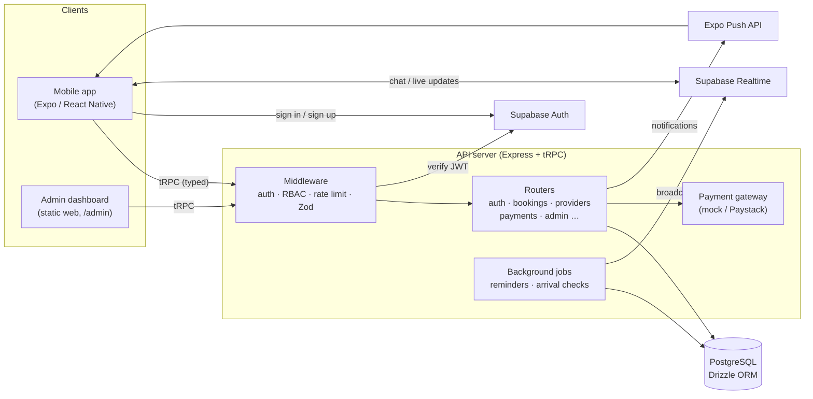
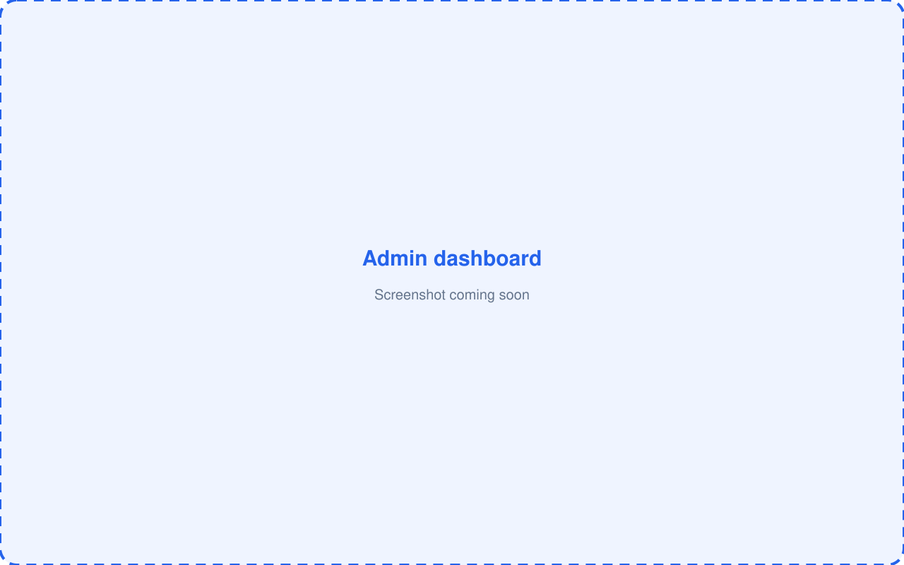

<div align="center">


# D'RANIK Techs

**A two-sided marketplace app for booking trusted local service professionals in Nigeria.**

React Native (Expo) · TypeScript · tRPC · PostgreSQL · Supabase

</div>

> **Showcase repository.** This is a public snapshot of a production app that is in active development. The live project lives in a private repository. Credentials, project IDs, and internal notes have been removed or replaced with placeholders, so you'll need your own services to run it end to end.

---

## What it is

D'RANIK Techs connects customers with verified service providers, such as cleaners, plumbers, hairstylists, and technicians. Customers can find a professional nearby, agree on a price, book a time slot, and pay. Payment is held in escrow until the job is confirmed done. Providers get their own app area to run their business, and the operations team uses a separate web admin dashboard.

The app serves three roles:

| Role | What they do |
|------|--------------|
| **Customer** | Discover, compare, negotiate, book, pay, chat, and review |
| **Provider** | Onboard and get verified, list services, manage availability, accept jobs, track earnings |
| **Admin** | Verify providers, oversee bookings and payments, handle support, set commission |

## Key features

**For customers**
- Service discovery by category, search, trending, and personalised recommendations
- Distance-aware provider listings using device location
- Price negotiation with offers and counter-offers before booking
- Booking with live available time slots, lead-time rules, and a transparent fee and commission breakdown
- **Escrow-style payments:** funds are released to the provider only when the customer shares a one-time release code
- Live booking progress updates and automatic arrival checkpoints
- In-app chat with providers (Supabase Realtime)
- Wallet, coupons, saved addresses, favourites, and recently viewed
- Reviews and ratings, with provider responses
- Push notifications with per-type preferences, plus booking reminders
- Biometric app lock, and dark and light mode

**For providers**
- Guided onboarding with document upload for verification
- Service management, portfolio, and working hours and blocked dates
- Booking pipeline, cancellation requests, and negotiation inbox
- Dashboard, analytics, earnings, bank accounts, and withdrawals

**For admins (web dashboard at `/admin`)**
- Provider applications and document verification
- Users, bookings, cancellation requests, and held payments
- Finance and commission settings
- Support tickets, audit logs, and role-based admin access (RBAC)

## Tech stack

| Layer | Technology |
|-------|-----------|
| Mobile app | React Native 0.81, Expo SDK 54, Expo Router (file-based routing), React 19 + React Compiler |
| Styling | NativeWind 4 (Tailwind CSS), Reanimated |
| Data fetching | tRPC v11 client + TanStack Query, superjson |
| API server | Node.js, Express 5, tRPC v11, Zod validation, rate limiting |
| Database | PostgreSQL with Drizzle ORM (30+ tables) |
| Auth | Supabase Auth (email verification), with JWTs verified on the server |
| Realtime | Supabase Realtime broadcast (chat and booking updates) |
| Notifications | Expo Push API |
| Payments | Gateway abstraction (mock today, Paystack-ready) |
| Admin dashboard | Static HTML, CSS, and vanilla JS served by the API server |
| Testing | Vitest (unit and end-to-end against a real Postgres) |

## Architecture



- **End-to-end type safety.** The mobile app calls the server through tRPC, so API inputs and outputs are checked by TypeScript on both sides, and Zod validates them at runtime.
- **Role-based procedures.** Every endpoint runs through `public`, `protected`, `provider`, or `admin` middleware, and fine-grained admin roles are stored in the database.
- **Booking state machine.** Status changes follow an explicit transition table, and each change is written to a booking history table for auditing.
- **Money safety.** The wallet, payment, and transaction ledgers are separate tables. Escrow release codes are hashed with a server-side secret ("pepper").
- **Swappable payments.** Payments go through a gateway interface, so switching from mock to Paystack is a configuration change, not a schema change.

### Project structure

```
src/
├── app/              # Screens (Expo Router). (tabs)/ = customer app, provider-app/ = provider area
├── components/       # Reusable UI (cards, sheets, headers, skeletons…)
├── hooks/            # Auth, colour scheme, location
├── lib/              # tRPC client, Supabase client, local storage, geo helpers
├── server/
│   ├── _core/        # Express entry, tRPC setup, auth context, env, rate limiting
│   ├── routers.ts    # All API procedures
│   ├── db.ts         # Data access + business logic
│   ├── services/     # Payment gateway abstraction
│   ├── push.ts       # Expo push sender
│   └── realtime.ts   # Supabase broadcast helper
├── drizzle/          # Database schema + relations
└── tests/            # Vitest unit + e2e suites
public/admin/         # Admin web dashboard
scripts/              # .env loader, database seed script
```

## Screenshots

> Screenshots coming soon.

| Home | Search | Service detail | Booking |
|:---:|:---:|:---:|:---:|
|  |  |  |  |

| Chat | Provider dashboard |
|:---:|:---:|
|  |  |

**Admin dashboard**



## Running it locally

### Prerequisites
- [Node.js](https://nodejs.org/) 20 or newer, with npm
- A PostgreSQL database and a [Supabase](https://supabase.com/) project (the free tier is fine) for auth and realtime
- To run the app on a phone: the [Expo Go](https://expo.dev/go) app, or an iOS Simulator or Android emulator

### Setup

```bash
# 1. Install dependencies
npm install

# 2. Create your environment file, then fill in your own values
cp .env.example .env

# 3. Create the database tables from the Drizzle schema
npx drizzle-kit push

# 4. (Optional) Load realistic sample data: categories, providers, services, reviews
npm run seed

# 5. Start the API server (http://localhost:3000, admin dashboard at /admin)
npm run server

# 6. In a second terminal, start the mobile app
npm start
```

Then scan the QR code with Expo Go, or press `i` (iOS) or `a` (Android) for a simulator. Press `w` to open the web build.

> Most features need a PostgreSQL database. Without `DATABASE_URL`, the server only keeps users in memory, and they're lost on restart. Payments run in `mock` mode by default, so no real money moves.

The admin panel (`public/admin/js/config.js`) also needs your Supabase URL and anon key.

## Running the tests

```bash
npm test          # run all Vitest suites once
npm run check     # TypeScript type-check (no emit)
```

The suite has 100+ tests across 16 files. They cover booking logic, the payment and escrow flow, commission, negotiations, provider availability, reminders, email verification, account deletion, and admin RBAC.

- **Unit tests** run with no setup.
- **End-to-end tests** run against a real Postgres database, and only if `TEST_DATABASE_URL` is set. Otherwise they are skipped. Tests never use `DATABASE_URL`, so a production database can't be touched by a test run. Use a separate, disposable database.

## Status

D'RANIK Techs is a production app **in active development**. This repository is a portfolio showcase and may lag behind the private codebase.

## License

© D'RANIK Techs. All rights reserved. This code is shared for portfolio and review purposes only.
